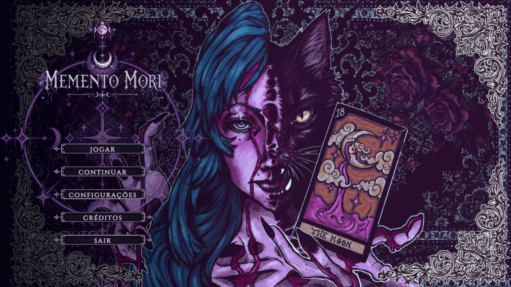
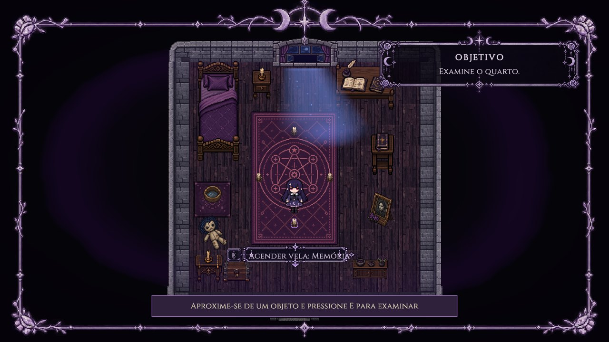
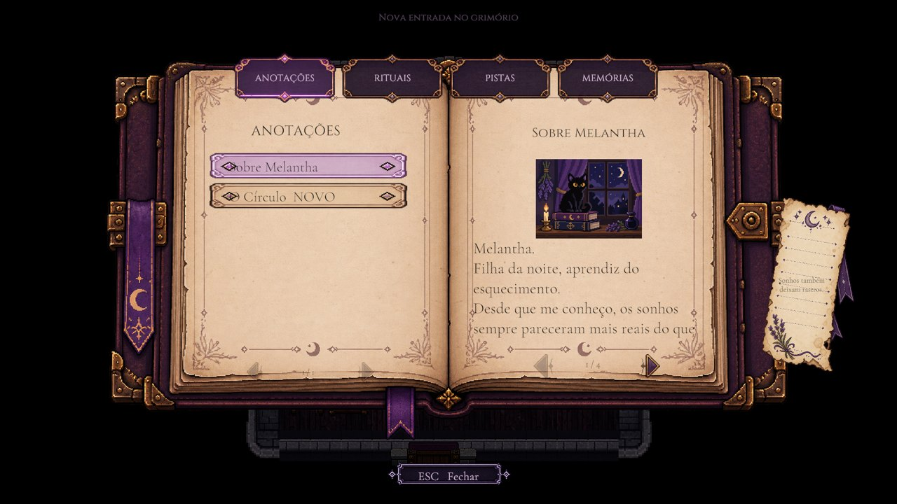
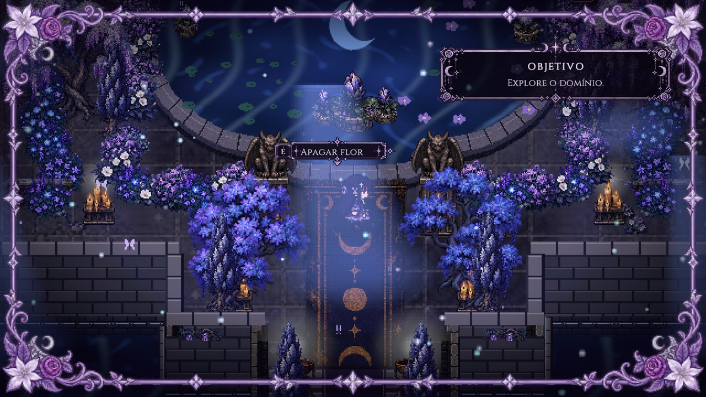
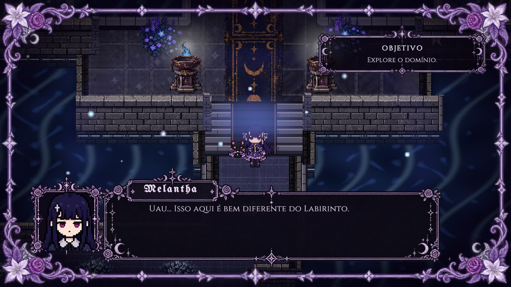
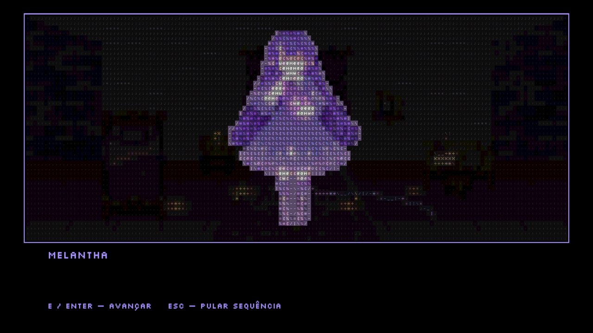

<h1 align="center">☾ Memento Mori ☽</h1>

<em>Exploração narrativa e puzzles em pixel art gótica.</em>

  
  
  
  
  

---

## Sumário

1. [Sobre o Memento Mori](#sobre-o-memento-mori)
2. [História e atmosfera](#história-e-atmosfera)
3. [Tarot, cartas e simbologia](#tarot-cartas-e-simbologia)
4. [Personagens](#personagens)
5. [Ambientes](#ambientes)
6. [Mecânicas e Grimório](#mecânicas-e-grimório)
7. [Tecnologias e arquitetura](#tecnologias-e-arquitetura)
8. [Como executar](#como-executar)
9. [Controles](#controles)
10. [Capturas](#capturas)
11. [Testes](#testes)
12. [Equipe e créditos](#equipe-e-créditos)
13. [Estado atual e publicação](#estado-atual-e-publicação)

---

## Sobre o Memento Mori

**Memento Mori** é um jogo 2D de exploração narrativa, desenvolvido em Unity como projeto acadêmico. O jogador acompanha Melantha por um percurso que começa no próprio quarto e atravessa espaços oníricos — um labirinto que parece lembrado, e não construído, e um domínio regido pela Lua — resolvendo rituais e puzzles simbólicos e registrando o que descobre em um grimório.

O foco está na atmosfera, na leitura do ambiente e na interpretação de símbolos, mais do que em combate ou reflexos.

## História e atmosfera

Melantha escreve para perceber quando algo desaparece. Em uma noite comum, o quarto que ela conhece tábua por tábua continua no lugar — mas muda de significado. Um círculo ritual interrompido, quatro velas e uma janela aberta para a Lua são o ponto de partida.

A partir dali, cada ambiente funciona como um estado de memória: corredores que devolvem ao mesmo lugar, vozes que sabem o que não foi dito, reflexos que chegam tarde ou cedo demais. As escolhas e respostas do jogador não servem para "vencer" o lugar, mas para entender o que ele está tentando dizer. A narrativa é apresentada em diálogos, entradas do grimório e cutscenes em arte ASCII.

> *"Que eu não me esqueça."* — Grimório de Melantha

## Tarot, cartas e simbologia

O tarot é parte da identidade do jogo, não apenas decoração. No Memento Mori ele é usado como **repertório narrativo e estético** — uma linguagem de imagens conhecida culturalmente que o jogo reinterpreta à sua maneira. Não se trata de apresentar práticas esotéricas como verdadeiras, e sim de usar seus símbolos para construir sentido.

- **Os Sete Domínios.** O Labirinto conduz a sete portais, cada um associado a um Arcano Maior: **A Lua, A Torre, O Enforcado, O Eremita, O Diabo, A Morte e O Julgamento**. No grimório, eles não são "portas no sentido comum", mas maneiras diferentes de atravessar a mesma coisa. Nesta versão, apenas **A Lua** responde.
- **A Lua como eixo.** O Arcano XVIII aparece na ilustração de abertura e organiza o domínio jogável: reflexos, fases, ciclos e aquilo que nunca se mostra por inteiro. Os puzzles do Jardim Lunar seguem as fases (crescente, cheia, minguante, nova) e a Sala dos Espelhos trabalha a relação entre imagem, tempo e lugar.
- **Rituais e significados.** O ritual do quarto pede quatro chamas acesas pela ordem do *significado*, e não da posição. O sigilo final é reconstruído por fase, registro e intenção. A simbologia é, portanto, a regra do puzzle.
- **O Grimório** organiza esse conhecimento: anotações, princípios rituais, pistas progressivas e rastros de memória, liberados conforme Melantha avança.

A leitura simbólica apresentada aqui é a interpretação artística do próprio jogo; ela não substitui as tradições históricas do tarot.

## Personagens

| Personagem | Papel |
|---|---|
| **Melantha** | Protagonista. "Filha da noite, aprendiz do esquecimento." Registra tudo no grimório. |
| **Poe** | Gato companheiro. Não pergunta, só fica — e parece saber o que ela procura antes dela. |
| **Andrealphus** | Presença aviária que fala como quem já conhece o fim da conversa. |

## Ambientes

| Ambiente | Descrição |
|---|---|
| **Quarto** | Ponto de partida: o ritual das quatro velas, a janela, o retrato e o grimório. |
| **Labirinto** | Catorze setores: Corredor dos Ecos, Porta Falsa, Poço de Vozes, Pátio sem Céu, Núcleo e os santuários dos Sete Domínios. |
| **Domínio da Lua** | Jardim Lunar, Sala dos Sete Espelhos, Corredor Ilusório, Galeria dos Ciclos, Câmara do Sigilo e o Portal Final. |
| **Retorno** | O quarto real, pela manhã. |

## Mecânicas e Grimório

- Exploração top-down com interação contextual (o prompt aparece junto ao objeto mais próximo).
- Ritual do quarto, puzzles de eco e escolha, poço de vozes, porta falsa, fases lunares, espelhos e sigilo.
- **Grimório** com quatro abas — *Anotações, Rituais, Pistas e Memórias* — e 40 entradas liberadas pela progressão; as pistas dos puzzles têm três níveis.
- Diálogos, escolhas e 12 cutscenes em arte ASCII animada.
- Salvamento em slots e retomada pelo menu (*Continuar*).
- Vegetação e chamas semitransparentes quando cobrem a personagem; iluminação 2D, água, luar, vaga-lumes e borboletas por shaders e partículas.

## Tecnologias e arquitetura

| Item | Uso |
|---|---|
| Unity **6000.4.12f1** | Engine |
| C# | Todo o código do jogo (`Assets/Scripts/Jogo`, assembly `MementoMori.Runtime`) |
| URP 2D 17.4 | Renderização, Light2D, shaders próprios (`Assets/Shaders`) |
| Tilemaps 2D | Mapas, colisão (`CollisionBoundary`) e piso navegável |
| uGUI + TextMeshPro | Interface, diálogos, grimório |
| Unity Test Framework 1.6 | Testes EditMode e PlayMode (`Assets/Tests`) |

Organização do código: `Core` (estado, salvamento, entrada), `Interaction`, `Dialogue`, `Narrative`, `Puzzles`, `Poe`, `Player`, `World`, `UI`, `Audio` e `Verification` (percurso automatizado de aceitação, só em builds de desenvolvimento). Ferramentas de editor reprodutíveis ficam em `Assets/Editor`.

## Como executar

**Jogando a build:** extraia o ZIP e execute `MementoMori.exe` (mantenha a pasta `MementoMori_Data` ao lado do executável).

**Pelo código-fonte:**

1. Clone o repositório: `git clone https://github.com/mesferatus/MementoMori-GameDev.git`
2. Abra a pasta no Unity Hub com o Editor **6000.4.12f1**.
3. Abra `Assets/Scenes/MainMenu.unity` e pressione **Play**.

As cenas da build, em ordem: `MainMenu`, `Quarto`, `Labirinto`, `DominioLua`, `FinalBeta`.

## Controles

| Ação | Tecla padrão |
|---|---|
| Mover | **W A S D** ou setas |
| Interagir / avançar diálogo | **E** (Enter também avança cutscenes) |
| Grimório | **G** |
| Pausa / voltar | **Esc** |
| Pular cutscene | **Esc** |

As teclas de ação podem ser remapeadas em *Configurações*.

## Capturas

| | |
|---|---|
|  |  |
|  |  |
|  | |

## Testes

| Suíte | Resultado (06/11/2026) |
|---|---|
| EditMode | 68/68 |
| PlayMode | 27/28 — a falha restante é um erro de log de um plugin de automação do Editor durante o teste ASCII, não do jogo |
| Percurso automatizado | CT-001 a CT-006 aprovados; CT-007 a CT-011 ainda não automatizados |

## Equipe e créditos

| Pessoa | Contribuição |
|---|---|
| **Callisto Monteiro Mascoloti** | Programação, integração, shaders programados, áudio e testes |
| **Luiza Canova** | Direção de arte, cenários, sprites, organização visual, colliders e narrativa |
| **Camila** | Ilustração original usada no menu e na tela final |

Ferramentas de IA (Claude e Codex) foram usadas como apoio à programação, à geração de peças auxiliares e à documentação, sob direção e revisão da equipe; o registro detalhado consta da documentação acadêmica do projeto.

## Estado atual e publicação

Versão acadêmica jogável do início ao fim do recorte (Quarto → Labirinto → Domínio da Lua → retorno). A página no itch.io será publicada pela equipe; o link será adicionado aqui quando estiver no ar.

Licença: ainda não definida pela equipe — todos os direitos reservados aos autores até a definição.
